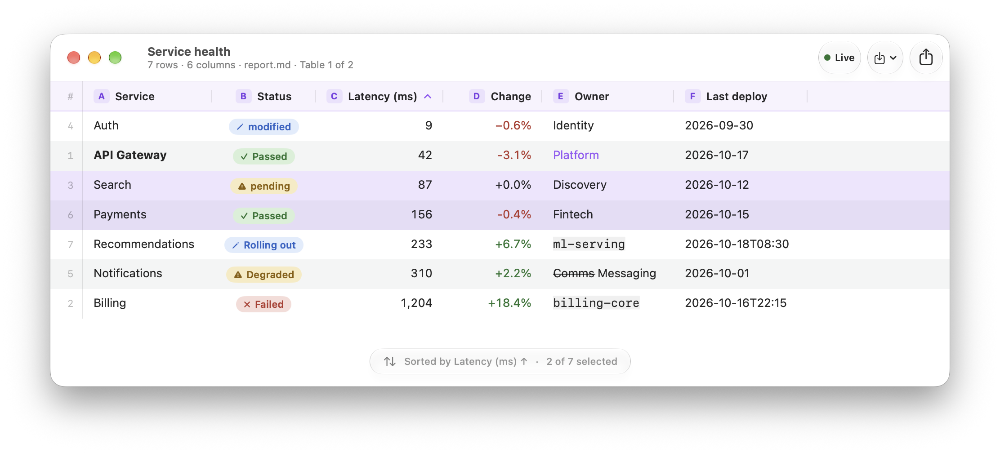
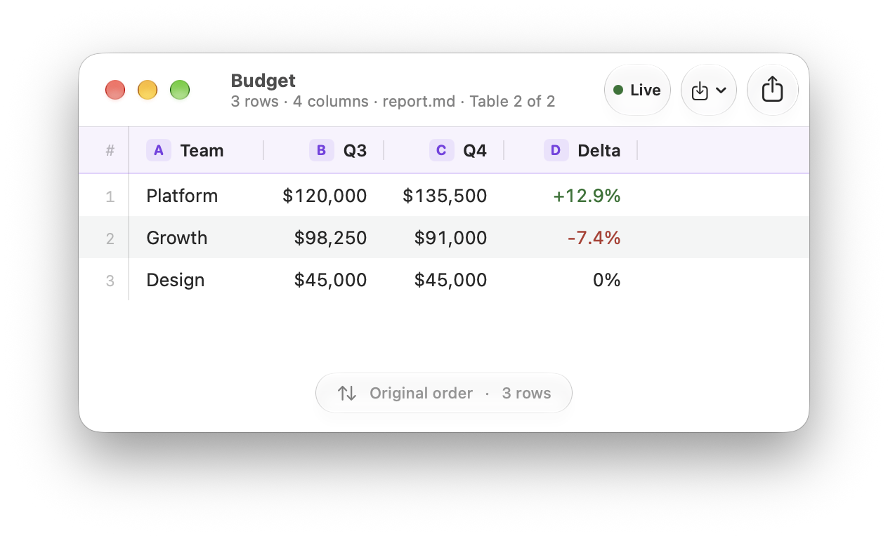
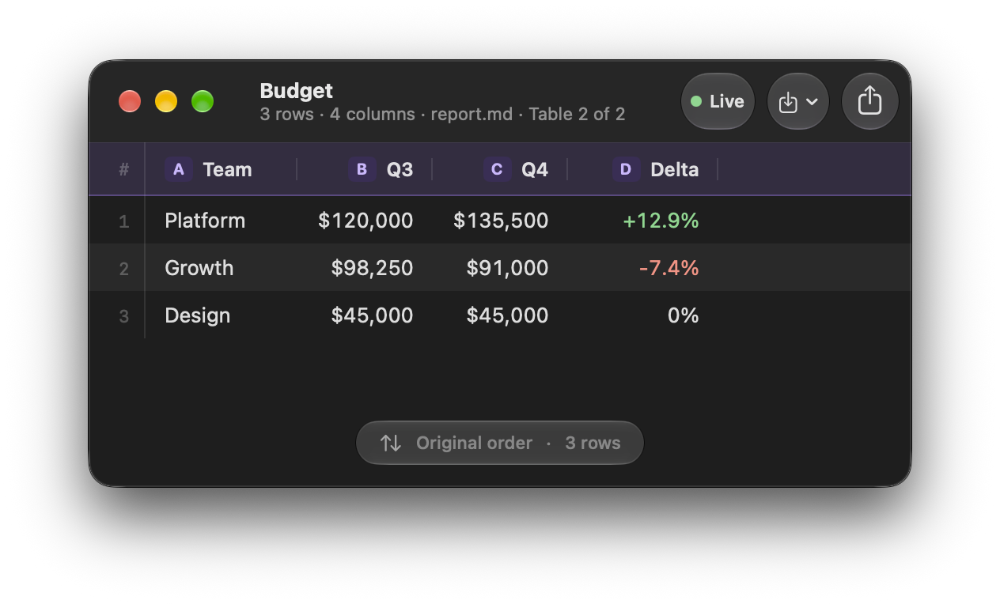
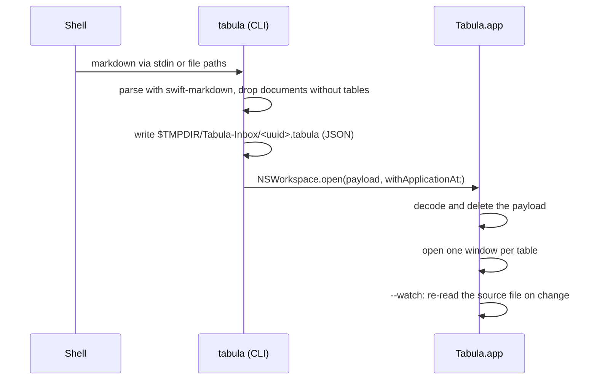

<p align="center">
  <picture>
    <source media="(prefers-color-scheme: dark)" srcset="docs/screenshots/hero-dark.png">
    
  </picture>
</p>

<h1 align="center">Tabula</h1>

<p align="center">
  <strong>Markdown tables from your terminal, rendered as native macOS windows.</strong><br>
  Pipe markdown in and each table opens in its own sortable, selectable, exportable window.
</p>

<p align="center">
  
  
</p>

```sh
cat report.md | tabula
```

Tabula is a SwiftUI + AppKit app for macOS 26 and later, with a small `tabula` command-line tool bundled inside it. Hand it any markdown, such as a report, LLM output or the result of a SQL query. Every [GitHub-flavored markdown table](https://github.github.com/gfm/#tables-extension-) it finds opens in a new window, styled after [Kaleidoscope](https://kaleidoscope.app) and framed in Liquid Glass. Nothing is saved, and the windows go away when you close them.

## Features

- **One window per table.** Each window is titled with the nearest heading above the table, or the file name if there is none. The subtitle shows the row and column counts, the source file, and the table's position (for example "Table 2 of 3").
- **Status values become pills.** Recognized status words and symbols are shown as colored pills: `✅ Passed`, `❌ Failed`, `pending`, `⚠️ Degraded`, `modified` and others.
- **Signed numbers are colored.** `+18.4%` is green, `-3.1%` and `−0.6%` are red, and `+0.0%` is left neutral.
- **Inline markdown renders.** Bold, italics, ~~strikethrough~~, `code` chips, links, escaped pipes (`\|`) and `<br>` line breaks all display properly.
- **Click to sort.** Columns sort as numbers, dates or text depending on their content. Text uses natural order (`file2` comes before `file10`), and empty cells always go last.
- **Finder-style selection.** Click, ⌘-click and ⇧-click select rows, as do ↑/↓ and ⇧↑/⇧↓. ⌘A selects all and Esc clears.
- **Copy that pastes anywhere.** ⌘C puts the selected rows on the clipboard as Markdown, HTML and tab-separated text. Each app picks the format it understands: editors get Markdown, Mail and Notes get a table, Numbers and Excel get cells.
- **Export.** Save the table as CSV, PNG or multi-page PDF, or send a PNG through the Share menu. Exports match the window's light or dark appearance.
- **Live reload with `--watch`.** Windows update when the file changes, including after atomic saves from editors and `sed -i`.
- **Pinned header.** A violet-badged header row stays at the top as you scroll, along with a line-number gutter, zebra striping and a glass status capsule.

## Install

You need **macOS 26 or later** and **Xcode** at `/Applications/Xcode.app`. Xcode is required because the Command Line Tools alone don't include the SwiftUI macro plugin; the build selects Xcode automatically.

```sh
git clone https://github.com/jkieley/tabula.git
cd tabula
make install
```

`make install` builds a release `Tabula.app`, signs it ad hoc, copies it to `~/Applications`, and links the CLI into `~/.local/bin`:

```
~/Applications/Tabula.app/Contents/MacOS/Tabula      ← the app
~/Applications/Tabula.app/Contents/Helpers/tabula    ← the CLI
~/.local/bin/tabula -> …/Contents/Helpers/tabula
```

Make sure `~/.local/bin` is on your `PATH`. To remove everything, run `make uninstall`.

## Usage

### Pipe markdown in

```sh
cat report.md | tabula
```

```sh
cat <<'EOF' | tabula
## Service health
| Service | Status | Latency (ms) | Change |
|:--------|:------:|-------------:|-------:|
| **API Gateway** | ✅ Passed | 42 | -3.1% |
| Billing | ❌ Failed | 1,204 | +18.4% |
| Search | pending | 87 | +0.0% |
| Notifications | ⚠️ Degraded | 310 | +2.2% |
EOF
```

### Open files

```sh
tabula report.md                       # every table in report.md
tabula q3.md q4.md                     # several files at once
tabula report.md --title "Q3 Revenue"  # override the window title
cat notes.md | tabula intro.md - outro.md   # "-" reads standard input in that position
```

### Keep windows live

```sh
tabula --watch report.md
```

A green **Live** badge appears in the toolbar. Save the file in any editor and the windows update within about 150 ms, keeping the current sort.

- If the file is moved or deleted, the badge turns amber (**Paused**) and Tabula keeps retrying until the file is back.
- Windows follow their table **by position**. If table 2 disappears from the file, its window shows *Table not found* until it comes back.

### From other tools

Any tool that can print a markdown table works.

```sh
# SQLite has a built-in markdown output mode
sqlite3 -markdown app.db "select name, plan, mrr from accounts order by mrr desc limit 50" | tabula

# GitHub CLI + jq: your repositories as a table
gh repo list --limit 20 --json name,stargazerCount,updatedAt --jq \
  '["| Repo | Stars | Updated |", "|---|---:|---|"]
   + map("| \(.name) | \(.stargazerCount) | \(.updatedAt[:10]) |") | .[]' \
  | tabula --title "My repos"

# Any LLM CLI that answers in markdown
your-llm-cli "Compare Postgres, MySQL and SQLite as a markdown table" | tabula
```

## How cells are styled

Tabula classifies each body cell by its **whole** text, so "Passed with warnings" stays plain text. Header cells are never styled.

| Detected | Examples | Shown as |
|---|---|---|
| Positive status | `✅` `✓` `🟢` · yes, true, pass, passed, ok, success, done, complete, added, enabled, active, online, healthy, approved, merged, resolved, up | Green pill |
| Negative status | `❌` `✗` `🔴` `⛔` · no, false, fail, failed, error, removed, deleted, disabled, offline, rejected, blocked, broken, down, missing | Red pill |
| Warning status | `⚠️` `🟡` `🟠` · warn, warning, pending, wip, in progress, skipped, partial, degraded, flaky, draft, todo, deprecated | Amber pill |
| Changed status | `✏️` `✎` `🔵` · changed, modified, updated, renamed, moved, edited | Blue pill |
| A status symbol followed by a short label | `🔵 Rolling out`, `✅ Shipped` | Pill in the symbol's color |
| Explicitly signed number | `+12.4%` · `-3.1%` · `−0.6%` | Green or red text (zero stays neutral) |

A column's content also decides how it sorts and aligns:

| Column content | Sorts as | Default alignment |
|---|---|---|
| Every non-empty cell is a number (`1,204`, `$1.5`, `12%`, `-3`, `.5`) | Number | Right |
| Every non-empty cell is an ISO date or datetime (`2026-10-17`, `2026-10-16T22:15`, `… 22:15:00+02:00`) | Date | Left |
| Anything else | Natural text order | Left |

Alignment markers in the table's delimiter row (`:--`, `:-:`, `--:`) always override the default.

## Keyboard and mouse

| Action | Input |
|---|---|
| Sort by a column (ascending → descending → original order) | Click the column header |
| Select a row | Click |
| Add or remove a row from the selection | ⌘-click |
| Select a range | ⇧-click |
| Move the selection / extend it | ↑ ↓ / ⇧↑ ⇧↓ |
| Select all / clear the selection | ⌘A / Esc |
| Copy the selected rows (Markdown, HTML, TSV) | ⌘C |
| Export | File ▸ Export as CSV… / PNG… / PDF…, or the toolbar's Export menu |
| Share as PNG | Toolbar Share button |

Copy and export always follow the current sort order.

**Export details:**
- **CSV:** RFC 4180 with CRLF line endings, always every row.
- **PNG:** the title, subtitle and table card, up to 1,000 rows. When rows are cut, a footnote says how many and suggests CSV.
- **PDF:** 40 rows per page, with the header row repeated on every page.

## CLI reference

```
OVERVIEW: Render markdown tables in native macOS windows.

USAGE: tabula [<files> ...] [--title <title>] [--watch]

ARGUMENTS:
  <files>                 Markdown files to read. Use - for standard input.

OPTIONS:
  -t, --title <title>     Window title (defaults to the nearest heading above
                          each table, else the file name).
  -w, --watch             Keep windows updated when the file changes (files
                          only).
  --version               Show the version.
  -h, --help              Show help information.
```

| Exit code | Meaning |
|---|---|
| `0` | Tables were handed to Tabula.app. The CLI returns right away and doesn't wait for windows. |
| `1` | A file couldn't be read, input wasn't UTF-8, or no tables were found. |
| `64` | Invalid usage, for example `--watch` with standard input, `-` given twice, or no input at all. |
| `69` | Tabula.app couldn't be found or opened. |

## How it works



The CLI finds the app through its own location inside the bundle (`Contents/Helpers/tabula`). If that fails, it falls back to the bundle ID `com.jkieley.Tabula`.

### Project layout

| Path | Contents |
|---|---|
| `Sources/TabulaCore` | Shared code with no UI. Parsing (swift-markdown, GFM tables and spans), inline rendering to `AttributedString`, value classification, sorting, selection, serializers, window titles, and the payload format. |
| `Sources/TabulaCLI` | The `tabula` command, built on swift-argument-parser. |
| `Sources/TabulaApp` | The AppKit app lifecycle, SwiftUI views, design tokens, export and share, and the file watcher. |
| `Tests/TabulaCoreTests` | Swift Testing suites for the core logic. |
| `scripts/build-app.sh` | Assembles and signs `build/Tabula.app`. |

### Development

```sh
make build      # debug build
make test       # Swift Testing suites
make app        # release bundle in build/Tabula.app
make install    # app → ~/Applications, CLI → ~/.local/bin
make clean
```

## Troubleshooting

- **`tabula: Tabula.app not found`**: run `make install` from the repository. If you moved the app, open it once so Launch Services registers it again.
- **`external macro implementation … SwiftUIMacros … not found`**: you're building with the Command Line Tools only. Install Xcode, or run with `DEVELOPER_DIR=/path/to/Xcode.app/Contents/Developer`.
- **`tabula: no tables found`**: check that the table has a delimiter row (`|---|---|`) directly under its header row.
